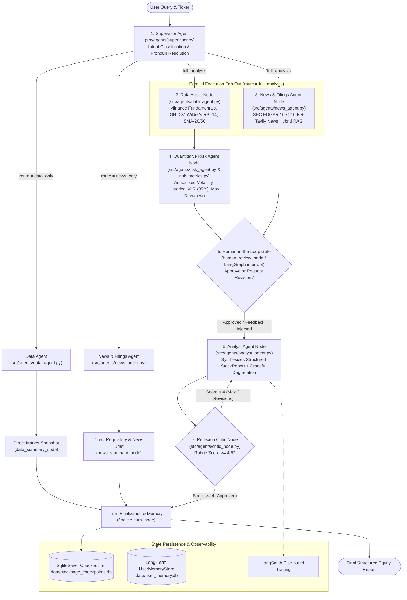
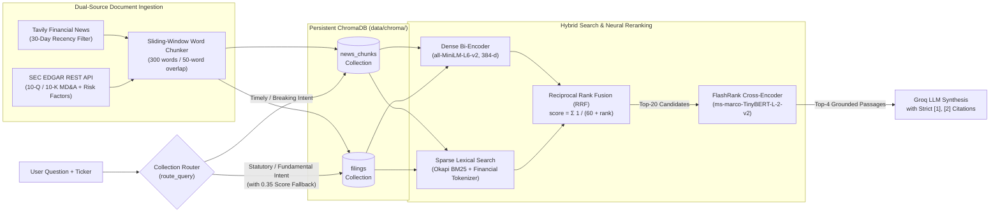

# StockSage 📈

[](https://github.com/sugam24/STOCKSAGE/actions/workflows/ci.yml)
[](https://share.streamlit.io)
[](https://fastapi.tiangolo.com)
[](https://streamlit.io)
[](https://langchain-ai.github.io/langgraph/)
[](https://trychroma.com/)
[](https://www.docker.com/)
[](https://www.python.org/)
[](https://opensource.org/licenses/MIT)

> **An institutional-grade, autonomous multi-agent financial research platform powered by LangGraph, Hybrid RAG (Dense Embeddings + BM25 + Cross-Encoder Reranking), Quantitative Risk Modeling, FastAPI, and Streamlit.**

---

## Executive Summary

Standard Large Language Models fail at institutional equity research due to **stale training cutoffs**, **arithmetic hallucinations**, and **unverifiable claims**. **StockSage** eliminates these failure modes by decoupling data retrieval, mathematical computation, qualitative RAG synthesis, and editorial verification into a deterministic **LangGraph Multi-Agent State Machine**:

1. **Intent Classification & Conditional Routing**: A **Supervisor Agent** resolves multi-turn conversational context and dynamically routes queries—executing lightweight single-agent paths (`data_only` or `news_only` to save up to 75% in token compute) or triggering a full multi-agent deep-research workflow (`full_analysis`).
2. **Parallel Fan-Out Ingestion**: The **Data Agent** (live market fundamentals & Wilder's RSI/SMA technical indicators) and **News & Filings Agent** (SEC EDGAR 10-Q/10-K filings + real-time financial news via Hybrid RAG) execute concurrently, cutting data collection latency by ~40%.
3. **Deterministic Quantitative Risk Engine**: A dedicated **Risk Agent** computes Annualized Volatility, 95% Historical Value at Risk ($\text{VaR}_{95\%}$), Maximum Drawdown ($\text{MDD}$), and Beta directly from historical OHLCV price series—never delegating math to an LLM.
4. **Human-in-the-Loop (HITL) Governance**: Integrates native LangGraph `interrupt()` checkpoints before synthesis, enabling analysts to inspect intermediate fundamentals, news snippets, and risk metrics to either approve synthesis or inject custom revision directives.
5. **Reflexion Self-Correction Loop**: An **Analyst Agent** synthesizes all findings into a structured `StockReport`, which is immediately audited by an independent **Critic Node** against an editorial rubric (completeness, citation rigor, bull/bear balance). Reports scoring $< 4/5$ are automatically routed back with targeted feedback for revision.

---

## Table of Contents

1. [System Architecture](#system-architecture)
2. [Engineering Highlights & Key Capabilities](#engineering-highlights--key-capabilities)
3. [4-Phase Engineering Architecture & File-by-File Reference](#4-phase-engineering-architecture--file-by-file-reference)
   - [Phase 1: Core Foundations, Tool-Calling Loop & Data Ingestion](#phase-1-core-foundations-tool-calling-loop--data-ingestion)
   - [Phase 2: Hybrid RAG Engine, SEC EDGAR & Golden Evaluation](#phase-2-hybrid-rag-engine-sec-edgar--golden-evaluation)
   - [Phase 3: Multi-Agent LangGraph Orchestration & Quantitative Risk](#phase-3-multi-agent-langgraph-orchestration--quantitative-risk)
   - [Phase 4: Full-Stack FastAPI Backend, Streamlit UI, Docker & CI/CD](#phase-4-full-stack-fastapi-backend-streamlit-ui-docker--cicd)
4. [Complete Repository Directory Tree](#complete-repository-directory-tree)
5. [RAG Benchmarking & Empirical Evaluation](#rag-benchmarking--empirical-evaluation)
6. [Getting Started & Installation](#getting-started--installation)
7. [Running StockSage (UI, API, Docker, CLI)](#running-stocksage-ui-api-docker-cli)
8. [Automated Test Suite & Continuous Integration](#automated-test-suite--continuous-integration)
9. [Tech Stack](#tech-stack)

---

## System Architecture

### 1. Multi-Agent LangGraph Orchestration Flow



### 2. Hybrid RAG & Multi-Collection Retrieval Pipeline



---

## Engineering Highlights & Key Capabilities

* **Hybrid Search with Reciprocal Rank Fusion (RRF) & Cross-Encoder Reranking**:
  Dense vector embeddings (`sentence-transformers/all-MiniLM-L6-v2`) capture semantic similarity but often miss exact financial tickers, dates, or GAAP line items. StockSage runs dense search in parallel with an **Okapi BM25** lexical index (`rank-bm25`), merges both candidate rankings via **Reciprocal Rank Fusion** ($k=60$), and passes the top 20 candidates through a local CPU **FlashRank Cross-Encoder** (`ms-marco-TinyBERT-L-2-v2`) to compute full cross-attention over `(query, passage)` pairs—achieving **100% retrieval precision (15/15)** on our golden benchmark.
* **Direct SEC EDGAR Regulatory Filing Ingestion**:
  Connects directly to the SEC EDGAR JSON submissions directory (`efts.sec.gov`) without paid third-party wrappers. Resolves `Ticker ➔ 10-digit CIK ➔ Accession Number`, parses deeply nested XBRL/HTML documents via BeautifulSoup, and isolates **Item 1A (Risk Factors)** and **Item 2 / Item 7 (MD&A)** into a dedicated `filings` vector collection.
* **From-Scratch Quantitative Financial Mathematics**:
  Implements **Wilder's Smoothed RSI (14-period)**, **Simple Moving Averages (SMA-20, SMA-50)**, **Annualized Volatility** ($\sigma_{\text{annual}} = \sigma_{\text{daily}} \times \sqrt{252}$), **95% Historical Value at Risk ($\text{VaR}_{95\%}$)**, **Maximum Drawdown ($\text{MDD}$)**, and **Multi-Asset Pearson Correlation Matrices** directly in Python/NumPy/Pandas with hand-calculated unit test verification.
* **Resilient Fault Tolerance & Graceful Degradation**:
  Every agent node is isolated within defensive exception boundaries. If an upstream API (e.g., Yahoo Finance or Tavily) experiences an outage or rate limit, the node logs the failure to `state["error_log"]` via non-destructive state reducers and supplies an explicit `"unavailable"` marker—allowing the Analyst Agent to disclose missing data transparently rather than crashing the graph.
* **Non-Blocking Async API & Real-Time WebSockets**:
  Multi-agent synthesis takes 10–25 seconds. The FastAPI backend (`POST /v1/analysis`) immediately returns a `session_id` and schedules execution in background workers while broadcasting real-time node transitions (`supervisor_started`, `data_agent_completed`, `pending_approval`, `complete`) over `/v1/ws/{session_id}` and supporting interactive HITL approval resume via `POST /v1/analysis/{session_id}/approval`.

---

## 4-Phase Engineering Architecture & File-by-File Reference

The platform is architected across **four modular engineering phases**. Below is the complete technical reference for every file in the repository.

---

### Phase 1: Core Foundations, Tool-Calling Loop & Data Ingestion

Phase 1 establishes the core LLM communication layer, deterministic Pydantic boundary validation, manual and automated function-calling tool dispatchers, and real-time market/news ingestion clients.

| File Path | Engineering Responsibility & Key Implementation Details |
|:---|:---|
| [`src/core/config.py`](src/core/config.py) | **Environment & Settings Manager**: Uses Pydantic `BaseSettings` (`SettingsConfigDict(env_file=".env", extra="allow")`) to validate API credentials (`GROQ_API_KEY`, `TAVILY_API_KEY`, `LANGCHAIN_API_KEY`) at startup so missing secrets fail fast at application boot. |
| [`src/core/llm/client.py`](src/core/llm/client.py) | **Resilient Groq LLM Client**: Wraps the Groq SDK with three production primitives: synchronous completions (`get_llm_response`), real-time token streaming (`_stream_completion` with delta accumulation and final chunk token usage reporting), and **exponential backoff retries** (`_call_with_backoff` catching `APIConnectionError`, `APITimeoutError`, and `RateLimitError` across 2s ➔ 4s intervals). |
| [`src/chat.py`](src/chat.py) | **Multi-Turn Financial CLI Assistant**: Interactive command-line chat loop maintaining stateful message history (`system`, `user`, `assistant` roles) governed by a strict institutional financial analyst persona. |
| [`src/core/schema.py`](src/core/schema.py) | **Core Pydantic Data Models**: Defines strict boundary schemas (`StockData` with `ticker`, `price`, `pe_ratio`) enforcing type validation and `.model_dump()` / `.model_validate()` serialization round-trips. |
| [`src/core/structured.py`](src/core/structured.py) | **Forced Structured Output Extractor**: Implements `extract(prompt, schema) -> BaseModel`. Dynamically converts any Pydantic model's `.model_json_schema()` into an OpenAI/Groq tool declaration and sets `tool_choice={"type": "function", "function": {"name": ...}}` to guarantee 100% schema-validated JSON output. |
| [`src/core/tool_calling.py`](src/core/tool_calling.py) | **Single-Turn Tool Execution Harness**: Demonstrates the foundational tool-calling protocol: exposes `get_current_price(ticker)` with a JSON tool schema to Groq, intercepts `tool_calls` blocks, executes the live Python function via `yfinance`, and returns the observation to the LLM. |
| [`src/core/tools.py`](src/core/tools.py) | **General ReAct Tool Dispatcher & Agent Loop**: Implements `ToolDispatcher` (a registry mapping tool names and normalized JSON schemas to Python callables) and `run_agent()`, a multi-step agentic `while` loop capable of chaining multiple tools (`get_current_price`, `get_pe_ratio`) with a hard `MAX_ITERATIONS = 5` safety guard against infinite loops. |
| [`src/ingestion/yfinance_client.py`](src/ingestion/yfinance_client.py) | **Yahoo Finance Market Data Client**: Production data access layer exposing `get_fundamentals(ticker) -> CompanyFundamentals` (15 validated fields including market cap, trailing/forward P/E, 52-week range, sector) and `get_price_history(ticker, period) -> PriceHistory` (chronological `PriceBar` OHLCV models with `NaN`-safe float coercion). |
| [`src/ingestion/explore_yfinance.py`](src/ingestion/explore_yfinance.py) | **Yahoo Finance Schema Inspector**: Diagnostic script inspecting raw `.info` dictionary keys and `.history()` DataFrame structures returned by `yfinance`. |
| [`src/ingestion/explore_pandas.py`](src/ingestion/explore_pandas.py) | **Time-Series DataFrame Pipeline**: Financial time-series transformations using `pandas`—date-window slicing, `.dropna()` / `.ffill()` missing-data imputation, and rolling window aggregations. |
| [`src/ingestion/technical.py`](src/ingestion/technical.py) | **From-Scratch Technical Indicators Engine**: Implements `compute_rsi(prices, period=14)` using **Wilder's Smoothed Moving Average (SMMA)** method (handling zero-gain/zero-loss edge cases), `compute_moving_averages(prices)` for 20-day and 50-day SMAs, and `get_technical_signals(ticker)` returning a validated `TechnicalSignals` model. |
| [`src/ingestion/tavily_client.py`](src/ingestion/tavily_client.py) | **Tavily Financial News Client**: Implements `search_news(ticker)` and `filter_recent(results, max_age_days=30)` with a multi-format date parser (ISO-8601 + RFC-2822 fallback) to drop stale articles. |
| [`src/pipeline.py`](src/pipeline.py) | **Phase 1 End-to-End Integration Pipeline**: Chains fundamentals, 6-month OHLCV history, Wilder's RSI/SMA signals, and recent Tavily news into a single prompt and extracts a validated `TickerSummary` (`ticker`, `summary`, `sentiment`) via forced function calling. |

---

### Phase 2: Hybrid RAG Engine, SEC EDGAR & Golden Evaluation

Phase 2 builds a dual-collection Retrieval-Augmented Generation (RAG) engine combining dense embeddings, sparse BM25 keyword search, Reciprocal Rank Fusion, cross-encoder neural reranking, and official SEC EDGAR filings, verified by a deterministic evaluation suite.

| File Path | Engineering Responsibility & Key Implementation Details |
|:---|:---|
| [`src/rag/embeddings.py`](src/rag/embeddings.py) | **Local Dense Embedding Engine**: Wraps `sentence-transformers/all-MiniLM-L6-v2` (384-dimensional vectors) using a lazy-loaded singleton pattern for zero-cost local CPU inference and includes manual NumPy cosine similarity verification. |
| [`src/rag/vectorstore.py`](src/rag/vectorstore.py) | **ChromaDB Persistent Vector Store**: Manages persistent local vector collections (`data/chroma/`) configured with cosine distance space (`hnsw:space = "cosine"`). Exposes idempotent `add_documents()` (upsert) and metadata-filtered `query_collection()`. |
| [`src/rag/chunker.py`](src/rag/chunker.py) | **Sliding-Window Word Chunker**: Splits long financial articles and SEC filings into 300-word chunks with a 50-word sliding overlap (`chunk_text` and `chunk_documents`), preserving numerical figures and multi-sentence financial context across chunk boundaries. |
| [`src/rag/retriever.py`](src/rag/retriever.py) | **Multi-Collection Semantic Retriever & Query Router**: Connects live Tavily news and SEC filings to ChromaDB (`index_ticker_news`, `retrieve`). Implements `route_query(query, ticker)` to route timely queries to `news_chunks` and statutory queries to `filings`, with automatic cross-collection fallback if confidence falls below `FILINGS_MIN_SCORE = 0.35`. |
| [`src/rag/bm25.py`](src/rag/bm25.py) | **Okapi BM25 Lexical Retriever**: Builds an on-demand `BM25Okapi` index over a ticker's stored ChromaDB chunks using a specialized financial tokenizer that preserves ticker symbols, GAAP numbers, and percentages while stripping possessives and punctuation. |
| [`src/rag/hybrid.py`](src/rag/hybrid.py) | **Reciprocal Rank Fusion (RRF) Merger**: Executes dense semantic search and sparse BM25 search concurrently and merges their ranked lists using score-agnostic RRF ($\text{score}(d) = \sum \frac{1}{60 + \text{rank}(d)}$), overcoming distribution skew between unbounded BM25 scores and cosine similarity. |
| [`src/rag/reranker.py`](src/rag/reranker.py) | **FlashRank Cross-Encoder Reranker**: Wraps `ms-marco-TinyBERT-L-2-v2` to re-score candidate chunks via joint query-passage cross-attention, distilling noisy top-20 hybrid candidates down to the top-4 highest-precision passages. |
| [`src/rag/pipeline.py`](src/rag/pipeline.py) | **Unified Async RAG Pipeline**: Exposes `get_context(query, ticker)` and `answer_question(query, ticker)`. Orchestrates auto-indexing, collection routing, hybrid RRF retrieval ($k=20$), FlashRank reranking ($top\_n=4$), and grounded Groq synthesis with mandatory `[1]`, `[2]` source citations. |
| [`src/ingestion/edgar_client.py`](src/ingestion/edgar_client.py) | **SEC EDGAR 10-Q/10-K Filing Parser & Indexer**: Queries `sec.gov/files/company_tickers.json` and `data.sec.gov/submissions/` with SEC-compliant `User-Agent` headers. Downloads raw 10-Q/10-K HTML filings, strips inline XBRL tags, extracts **Risk Factors (Item 1A)** and **MD&A (Item 2/7)** via longest-span regex matching, chunks the text, and indexes into the `filings` ChromaDB collection. |
| [`src/rag/news_agent.py`](src/rag/news_agent.py) | **Standalone News & Filings Research Agent**: End-to-end RAG CLI agent that ingests fresh news and filings for single or multiple tickers (`--all`) and generates source-cited risk and catalyst briefs. |
| [`evaluation/golden_dataset.json`](evaluation/golden_dataset.json) | **Golden Evaluation Dataset**: 15 hand-curated institutional benchmark questions across `NVDA`, `AAPL`, and `TSLA` (spanning both breaking news and 10-Q statutory facts) paired with expected ground-truth facts and target collections. |
| [`evaluation/corpus_snapshot.json`](evaluation/corpus_snapshot.json) | **Deterministic Evaluation Corpus**: Frozen snapshot of news and SEC 10-Q chunks for `NVDA`, `AAPL`, and `TSLA` ensuring 100% reproducible RAG benchmarking across runs. |
| [`evaluation/build_snapshot.py`](evaluation/build_snapshot.py) | **Corpus Snapshot Utility**: Exports and re-hydrates ChromaDB collections to/from `corpus_snapshot.json`. |
| [`evaluation/evaluate.py`](evaluation/evaluate.py) | **Automated RAG Evaluation Harness**: Runs all 15 golden dataset queries through the full RAG pipeline and scores collection routing accuracy, chunk retrieval hit rate, and LLM factual answer fidelity. |
| [`evaluation/report.md`](evaluation/report.md) | **Empirical RAG Optimization Report**: Documents baseline evaluation (86.7% retrieval hit rate), root-cause failure diagnosis on boundary cutoffs, and parameter tuning ($k: 10 \rightarrow 20$, $top\_n: 3 \rightarrow 4$) that achieved **100% (15/15) retrieval and answer accuracy**. |

---

### Phase 3: Multi-Agent LangGraph Orchestration & Quantitative Risk

Phase 3 elevates StockSage into an autonomous multi-agent system coordinated by LangGraph, featuring conditional supervisor routing, parallel execution branches, quantitative risk modeling, SQLite checkpoint persistence, Human-in-the-Loop gates, cross-session memory, multi-ticker portfolio correlation analysis, and Reflexion self-correction.

| File Path | Engineering Responsibility & Key Implementation Details |
|:---|:---|
| [`src/core/langchain_basics.py`](src/core/langchain_basics.py) | **LangChain & LCEL Abstractions**: Wraps `ChatGroq`, `ChatPromptTemplate`, and `StrOutputParser` into declarative LCEL pipelines (`prompt \| client \| parser`) and benchmarks framework abstractions against manual client plumbing. |
| [`src/graph/intro.py`](src/graph/intro.py) | **LangGraph State Machine Primitives**: Reference implementation demonstrating typed state containers (`SimpleCountState`), pure node functions, and directed graph compilation (`StateGraph`). |
| [`src/graph/state.py`](src/graph/state.py) | **Shared Multi-Agent State Schema (`StockSageState`)**: Defines the central `TypedDict` flowing across all nodes (`ticker`, `user_query`, `route`, `stock_data`, `news_context`, `risk_metrics`, `final_report`, `revision_count`, `critique`, `human_feedback`) with custom non-destructive state reducers (`append_error`, `append_history`) so parallel nodes never overwrite each other's updates. |
| [`src/agents/supervisor.py`](src/agents/supervisor.py) | **Supervisor & Intent Router Node**: Analyzes user queries and in-session `conversation_history` (resolving pronouns like *"What is its P/E?"* to the active ticker) and outputs a validated `SupervisorDecision` selecting `data_only`, `news_only`, or `full_analysis`. |
| [`src/agents/data_agent.py`](src/agents/data_agent.py) | **Data Agent Node (`data_agent_node`)**: Asynchronous LangGraph node that fetches company fundamentals, 6-month closing price series, and Wilder's RSI/SMA technical indicators via `asyncio.to_thread`, writing validated `StockDataPayload` into state with graceful fallback on error. |
| [`src/agents/news_agent.py`](src/agents/news_agent.py) | **News & Filings Agent Node (`news_agent_node`)**: Asynchronous LangGraph node wrapping the Phase 2 Hybrid RAG + FlashRank pipeline over Tavily news and SEC 10-Q filings, attaching numbered, source-attributed context passages to `state["news_context"]`. |
| [`src/agents/risk_metrics.py`](src/agents/risk_metrics.py) | **Quantitative Risk Mathematics Module**: Pure mathematical implementation of `compute_daily_returns()`, `compute_volatility()` (annualized std dev $\times \sqrt{252}$), `compute_var()` (95% Historical Simulation Value at Risk), and `compute_max_drawdown()` (peak-to-trough decline). |
| [`src/agents/risk_agent.py`](src/agents/risk_agent.py) | **Risk Agent Node (`risk_agent_node`)**: Computes quantitative risk metrics from `state["stock_data"]["closes"]`, combines them with equity Beta, classifies overall risk into qualitative tiers (`Low`, `Moderate`, `Elevated`, `High`), and writes `RiskMetricsPayload` to state. |
| [`src/agents/analyst_agent.py`](src/agents/analyst_agent.py) | **Analyst Synthesis Node (`analyst_agent_node`)**: Synthesizes `stock_data`, `news_context`, `risk_metrics`, `user_context`, and any `human_feedback` or `critique` into a structured `StockReport` (`summary`, `bull_case`, `bear_case`, `risk_rating`) plus formatted institutional Markdown. Automatically detects and discloses any degraded/missing upstream data streams. |
| [`src/agents/critic_node.py`](src/agents/critic_node.py) | **Reflexion Critic Node (`critic_node`)**: Audits the Analyst's draft report against a 1–5 institutional rubric (`CriticEvaluation`: completeness, citation quality, quantitative precision, bull/bear balance) and triggers a self-correction loop (`should_revise_report`) back to the Analyst if `score < 4` (up to `MAX_REVISIONS = 2`). |
| [`src/graph/stocksage_graph.py`](src/graph/stocksage_graph.py) | **Master Multi-Agent StateGraph (`build_stocksage_graph`)**: Wires all specialist nodes together with conditional Supervisor routing, **parallel fan-out** (`data_agent` + `news_agent`), **Human-in-the-Loop `interrupt()` gate** (`human_review_node`), **Reflexion Critic loop**, and **SQLite checkpoint persistence** (`SqliteSaver` / `AsyncSqliteSaver`). |
| [`src/graph/memory.py`](src/graph/memory.py) | **Cross-Session Long-Term Memory (`UserMemoryStore`)**: Persistent SQLite store (`data/user_memory.db`) tracking analyzed tickers, query timestamps, and user risk/style preferences across separate application runs, injecting `user_context` at graph initialization. |
| [`src/graph/portfolio.py`](src/graph/portfolio.py) | **Multi-Ticker Portfolio & Correlation Engine**: Executes `data_agent` and `risk_agent` across multiple tickers in parallel via `asyncio.gather`, computes a full **pairwise Pearson correlation matrix** over daily return series, and evaluates portfolio-level diversification (`Strong`, `Moderate`, `Low`). |

---

### Phase 4: Full-Stack FastAPI Backend, Streamlit UI, Docker & CI/CD

Phase 4 exposes the multi-agent engine via an authenticated asynchronous FastAPI web server with live WebSockets, an interactive Streamlit financial dashboard with Plotly charts and HITL controls, Docker containerization, pre-flight diagnostics, and automated GitHub Actions CI.

| File Path | Engineering Responsibility & Key Implementation Details |
|:---|:---|
| [`src/api/main.py`](src/api/main.py) | **Production FastAPI Backend**: Implements `GET /health`, `GET /ping/{ticker}`, `POST /v1/analysis` (non-blocking background task execution), `GET /v1/analysis/{session_id}` (status & report polling), `POST /v1/analysis/{session_id}/approval` (resumes paused HITL sessions), and `WS /v1/ws/{session_id}` (real-time agent milestone streaming via `ConnectionManager`), secured by `X-API-Key` authentication (`verify_api_key`). |
| [`api/main.py`](api/main.py) | **Root ASGI Entrypoint Forwarding Wrapper**: Re-exports `app` and `main` from `src.api.main` so standard deployment commands (`uvicorn api.main:app`) work seamlessly out of the box. |
| [`demo/app.py`](demo/app.py) | **Streamlit Interactive Financial Dashboard**: Full-featured web frontend featuring sidebar API health checks, multi-environment secrets resolution (`st.secrets` ➔ `os.getenv`), interactive **Plotly 6-Month Price Trajectory charts**, **Plotly RSI-14 momentum gauges** (with Oversold/Neutral/Overbought zones), **clickable Human-in-the-Loop Approve / Request Revision controls**, and structured report rendering. |
| [`Dockerfile`](Dockerfile) | **Production Container Image**: Fast, layer-cached `python:3.12-slim` image powered by `uv sync --frozen`, pre-configuring `PYTHONPATH=/app/src`, local data directories, and native `/health` container checks. |
| [`docker-compose.yml`](docker-compose.yml) | **Multi-Container Stack Orchestration**: Defines `stocksage-api` (`:8000`) and `stocksage-ui` (`:8501`) services with shared `./data:/app/data` volume mounts for persistent ChromaDB vectors and SQLite checkpoints, healthcheck dependencies, and `.env` injection. |
| [`requirements.txt`](requirements.txt) | **Cloud Platform Dependency Lock**: Pinned dependency export for PaaS deployments (Railway, Render, Streamlit Community Cloud). |
| [`check_health.py`](check_health.py) | **9-Point Pre-Flight System & API Diagnostic Tool**: Audits Python 3.12+ runtime, `.venv` path integrity, `.env` keys, live Groq model availability, Tavily quota, SEC EDGAR User-Agent compliance, Yahoo Finance feeds, local `all-MiniLM-L6-v2` embeddings, ChromaDB read/write permissions, and FlashRank cross-encoder loading. |
| [`.github/workflows/ci.yml`](.github/workflows/ci.yml) | **GitHub Actions CI Pipeline**: Automatically provisions Ubuntu + Python 3.12 + `uv` on every push and pull request to `main`, running all offline unit and graph tests (`pytest -m "not integration"`). |

---

## Complete Repository Directory Tree

```text
StockSage/
├── .github/
│   └── workflows/
│       └── ci.yml                        # Automated GitHub Actions CI pipeline
├── api/
│   ├── __init__.py
│   └── main.py                           # Root FastAPI ASGI entrypoint wrapper
├── demo/
│   └── app.py                            # Interactive Streamlit UI, Plotly charts & HITL review gate
├── docs/
│   ├── phase1_notes.md                   # Phase 1 technical reference & engineering retrospective
│   ├── phase2_notes.md                   # Phase 2 RAG architecture reference & evaluation tuning
│   ├── phase3_notes.md                   # Phase 3 multi-agent system reference & state design
│   ├── phase4_notes.md                   # Phase 4 full-stack deployment & observability reference
│   └── concepts/
│       ├── agents.md                     # ReAct agent loop & transformer probability formulation
│       ├── langgraph.md                  # Deterministic StateGraph, nodes, edges & reducers
│       └── rag.md                        # Retrieval-Augmented Generation architecture notes
├── evaluation/
│   ├── build_snapshot.py                 # ChromaDB evaluation corpus snapshot builder
│   ├── corpus_snapshot.json              # Frozen deterministic corpus for NVDA, AAPL, TSLA
│   ├── evaluate.py                       # Automated RAG benchmark evaluation runner
│   ├── golden_dataset.json               # 15 ground-truth financial research benchmark questions
│   └── report.md                         # Documented optimization report (86.7% -> 100% precision)
├── src/
│   ├── __init__.py
│   ├── chat.py                           # Multi-turn CLI financial chatbot
│   ├── pipeline.py                       # Phase 1 end-to-end data + structured LLM summary pipeline
│   ├── core/
│   │   ├── __init__.py
│   │   ├── config.py                     # Pydantic BaseSettings environment loader
│   │   ├── langchain_basics.py           # LangChain ChatGroq & LCEL pipeline abstractions
│   │   ├── schema.py                     # Core Pydantic data validation schemas
│   │   ├── structured.py                 # Forced function-calling structured output extractor
│   │   ├── tool_calling.py               # Single-step live yfinance tool calling harness
│   │   ├── tools.py                      # Reusable ToolDispatcher & multi-step ReAct loop
│   │   └── llm/
│   │       ├── __init__.py
│   │       └── client.py                 # Groq client with streaming & exponential backoff retries
│   ├── ingestion/
│   │   ├── __init__.py
│   │   ├── edgar_client.py               # SEC EDGAR 10-Q/10-K HTML parser & ChromaDB indexer
│   │   ├── explore_pandas.py             # Pandas financial time-series exploration utility
│   │   ├── explore_yfinance.py           # Yahoo Finance payload inspection script
│   │   ├── tavily_client.py              # Tavily news search client with 30-day recency filter
│   │   ├── technical.py                  # From-scratch Wilder's RSI-14, SMA-20 & SMA-50 engine
│   │   └── yfinance_client.py            # Validated CompanyFundamentals & PriceHistory client
│   ├── rag/
│   │   ├── __init__.py
│   │   ├── bm25.py                       # Okapi BM25 lexical search with financial tokenizer
│   │   ├── chunker.py                    # 300-word sliding window chunker with 50-word overlap
│   │   ├── embeddings.py                 # Local CPU sentence-transformers (all-MiniLM-L6-v2)
│   │   ├── hybrid.py                     # Reciprocal Rank Fusion (RRF) hybrid retriever
│   │   ├── news_agent.py                 # Standalone multi-ticker RAG research CLI agent
│   │   ├── pipeline.py                   # End-to-end async multi-collection RAG pipeline
│   │   ├── reranker.py                   # FlashRank cross-encoder neural reranker
│   │   ├── retriever.py                  # Multi-collection semantic retriever & query router
│   │   └── vectorstore.py                # Persistent ChromaDB vector store wrapper
│   ├── agents/
│   │   ├── __init__.py
│   │   ├── analyst_agent.py              # Executive synthesis node with graceful degradation
│   │   ├── critic_node.py                # Reflexion self-evaluation & iterative critique node
│   │   ├── data_agent.py                 # Market fundamentals & technical signals LangGraph node
│   │   ├── news_agent.py                 # Hybrid RAG & SEC filings LangGraph node
│   │   ├── risk_agent.py                 # Quantitative risk classification LangGraph node
│   │   ├── risk_metrics.py               # Annualized Volatility, 95% Historical VaR, Max Drawdown
│   │   └── supervisor.py                 # Intent router & conversational pronoun resolver
│   ├── graph/
│   │   ├── __init__.py
│   │   ├── intro.py                      # Minimal StateGraph reference implementation
│   │   ├── memory.py                     # Cross-session SQLite long-term UserMemoryStore
│   │   ├── portfolio.py                  # Concurrent multi-ticker portfolio & correlation engine
│   │   ├── state.py                      # Typed StockSageState & concurrency-safe reducers
│   │   └── stocksage_graph.py            # Compiled multi-agent graph with parallel fan-out & HITL
│   └── api/
│       ├── __init__.py
│       └── main.py                       # FastAPI REST, background tasks, WebSockets & API auth
├── tests/                                # 22 modular test files (114+ offline unit tests)
│   ├── test_analyst_agent.py             # Analyst synthesis & structured report tests
│   ├── test_api.py                       # FastAPI endpoints, auth, HITL & background task tests
│   ├── test_critic.py                    # Reflexion critic rubric & revision loop routing tests
│   ├── test_data_agent.py                # Data Agent node execution tests
│   ├── test_graceful_degradation.py      # Partial report resilience under simulated API outages
│   ├── test_hitl.py                      # LangGraph interrupt() approval & revision gate tests
│   ├── test_intro_graph.py               # Foundational StateGraph transition tests
│   ├── test_langchain_basics.py          # LCEL chain & prompt template tests
│   ├── test_long_term_memory.py          # Cross-session SQLite UserMemoryStore persistence tests
│   ├── test_memory.py                    # In-session multi-turn conversation memory tests
│   ├── test_news_agent.py                # News Agent RAG node integration tests
│   ├── test_parallel_graph.py            # Parallel fan-out latency & state merge tests
│   ├── test_persistence.py               # SqliteSaver thread checkpointing & recovery tests
│   ├── test_portfolio.py                 # Multi-ticker Pearson correlation & portfolio risk tests
│   ├── test_rag.py                       # Chunker, BM25 financial tokenizer & RRF math tests
│   ├── test_risk_agent.py                # Risk Agent node & qualitative tier tests
│   ├── test_risk_metrics.py              # Hand-verified Volatility, VaR 95% & Max Drawdown tests
│   ├── test_schema.py                    # Pydantic schema validation & serialization tests
│   ├── test_state.py                     # StockSageState initialization & reducer tests
│   ├── test_stocksage_graph.py           # End-to-end StateGraph execution tests
│   ├── test_structured.py                # Forced tool-choice structured extraction tests
│   ├── test_supervisor.py                # Supervisor conditional routing & pronoun resolution tests
│   ├── test_technical.py                 # Hand-calculated Wilder's RSI & SMA verification tests
│   ├── test_tools.py                     # ToolDispatcher registry & max-iteration safety cap tests
│   └── test_yfinance_client.py           # Yahoo Finance Pydantic model & history tests
├── check_health.py                       # 9-point pre-flight environment & API diagnostic script
├── Dockerfile                            # Production container build with uv & Python 3.12
├── docker-compose.yml                    # Full-stack multi-container orchestration (API + UI)
├── pyproject.toml                        # Project metadata, dependencies & pytest configuration
├── requirements.txt                      # Exported dependencies for cloud hosting
└── uv.lock                               # Deterministic dependency lockfile
```

---

## RAG Benchmarking & Empirical Evaluation

Rather than relying on subjective "vibe checks," the StockSage RAG engine is benchmarked against a deterministic **15-question Golden Dataset** ([`evaluation/golden_dataset.json`](evaluation/golden_dataset.json)) covering `NVDA`, `AAPL`, and `TSLA` across both recent market news and statutory 10-Q SEC filings.

| Metric | Baseline Configuration ($k=10, \text{top\_n}=3$) | Optimized Configuration ($k=20, \text{top\_n}=4$) | Delta |
|:---|:---:|:---:|:---:|
| **Collection Routing Accuracy** | 15 / 15 (100.0%) | **15 / 15 (100.0%)** | — |
| **Chunk Retrieval Hit Rate** | 13 / 15 (86.7%) | **15 / 15 (100.0%)** | **+13.3%** |
| **Grounded Answer Accuracy** | 13 / 15 (86.7%) | **15 / 15 (100.0%)** | **+13.3%** |

* **Diagnostic Root-Cause Finding**: In baseline runs, two queries (`q10` on Apple regional performance and `q12` on Tesla delivery figures) missed because relevant chunks ranked between positions 11–16 in individual retrievers and were pruned before Reciprocal Rank Fusion.
* **Engineering Fix**: Expanding the per-retriever candidate pool from $k=10$ to $k=20$ before RRF and widening the FlashRank cross-encoder output window from $\text{top\_n}=3$ to $\text{top\_n}=4$ (~1,200 words) eliminated boundary truncation and raised precision to **100%**.
* Full diagnostic details are documented in [`evaluation/report.md`](evaluation/report.md).

```bash
# Run the deterministic RAG evaluation benchmark
uv run python -m evaluation.evaluate
```

---

## Getting Started & Installation

### Prerequisites
* **Python 3.12+**
* **[uv](https://docs.astral.sh/uv/)** (recommended for fast, deterministic lockfile installs) or standard `pip`
* **API Keys**:
  * [Groq Cloud API Key](https://console.groq.com/) (Free tier; powers ultra-fast LLM inference)
  * [Tavily Search API Key](https://tavily.com/) (Free tier includes 1,000 searches/month)
  * *(Optional)* [LangSmith API Key](https://smith.langchain.com/) (For distributed agent tracing)

### 1. Clone the Repository
```bash
git clone https://github.com/sugam24/STOCKSAGE.git
cd STOCKSAGE
```

### 2. Install Dependencies
Using **`uv`** (recommended):
```bash
uv sync --all-groups
```
Or using standard `venv` + `pip`:
```bash
python3 -m venv .venv
source .venv/bin/activate
pip install -r requirements.txt
pip install pytest
```

### 3. Configure Environment Variables
```bash
cp .env.example .env
```
Populate `.env` with your keys:
```env
GROQ_API_KEY=gsk_your_groq_api_key_here
TAVILY_API_KEY=tvly-your_tavily_api_key_here
STOCKSAGE_API_KEY=stocksage-dev-key-12345
SEC_USER_AGENT="StockSage Research your_email@example.com"

# Optional: LangSmith Observability
LANGCHAIN_TRACING_V2=true
LANGCHAIN_API_KEY=lsv2_pt_your_langsmith_key
LANGCHAIN_PROJECT=stocksage
```

### 4. Run Pre-Flight Health Diagnostics
Verify your Python environment, API keys, SEC EDGAR connectivity, ChromaDB permissions, and local ML models before launching:
```bash
uv run python check_health.py
```

---

## Running StockSage (UI, API, Docker, CLI)

### 1. Full Stack via Docker Compose (Recommended)
Spin up both the FastAPI backend (`:8000`) and Streamlit dashboard (`:8501`) in isolated containers with persistent volume mounts:
```bash
docker compose up --build
```
* **Streamlit Web UI**: `http://localhost:8501`
* **FastAPI Swagger Docs**: `http://localhost:8000/docs`

### 2. Run Locally (FastAPI Backend + Streamlit Frontend)
Start the FastAPI server in Terminal 1:
```bash
uv run uvicorn src.api.main:app --host 0.0.0.0 --port 8000 --reload
```
Launch the interactive Streamlit dashboard in Terminal 2:
```bash
uv run streamlit run demo/app.py
```

### 3. Run the Multi-Agent Graph from CLI
Execute a full multi-agent equity analysis (or targeted query) directly in your terminal:
```bash
# Full multi-agent institutional analysis
uv run python -m src.graph.stocksage_graph "Provide a comprehensive research report on NVDA"

# Targeted fast-route query (Supervisor automatically skips News & Risk agents)
uv run python -m src.graph.stocksage_graph "What is AAPL's current price and RSI?"
```

### 4. Run Multi-Ticker Portfolio Risk & Correlation Analysis
Analyze a portfolio of stocks concurrently with pairwise Pearson return correlations:
```bash
uv run python -m src.graph.portfolio AAPL MSFT NVDA
```

---

## Automated Test Suite & Continuous Integration

StockSage includes **22 modular test suites containing 114+ offline unit tests** across `tests/`. Every mathematical formula (Wilder's RSI, Annualized Volatility, Historical VaR 95%, Max Drawdown, Pearson Correlation, Reciprocal Rank Fusion) and every LangGraph edge transition (Supervisor routing, parallel fan-out, HITL interrupts, Critic self-correction loops, SQLite checkpoint recovery, graceful degradation) is verified deterministically without requiring live network calls.

```bash
# Run the complete offline unit test suite (114+ passing tests)
uv run pytest -v -m "not integration"

# Run specific architectural test suites
uv run pytest tests/test_api.py -v                    # FastAPI endpoints, auth & HITL resume
uv run pytest tests/test_risk_metrics.py -v           # Quantitative risk math verification
uv run pytest tests/test_rag.py -v                    # Chunker, BM25 tokenizer & Hybrid RRF
uv run pytest tests/test_critic.py tests/test_hitl.py # Reflexion loop & HITL gate tests
uv run pytest tests/test_graceful_degradation.py -v   # Fault-tolerant partial report tests
```

Every push and pull request to `main` is automatically validated by the [GitHub Actions CI workflow](.github/workflows/ci.yml).

---

## Tech Stack

| Layer | Technology | Role in StockSage |
|:---|:---|:---|
| **Multi-Agent Orchestration** | **LangGraph** & **LangChain** | Stateful graph execution, conditional routing, parallel fan-out, `interrupt()` HITL gates, and `SqliteSaver` checkpointing |
| **LLM Inference** | **Groq Cloud API** | Ultra-low-latency inference (`llama-3.3-70b-versatile` / `openai/gpt-oss-120b`) with forced function calling & JSON mode |
| **Hybrid Retrieval (RAG)** | **ChromaDB**, **Sentence-Transformers**, **rank-bm25**, **FlashRank** | Persistent cosine vector store, `all-MiniLM-L6-v2` embeddings, Okapi BM25 lexical search, RRF fusion, and `ms-marco-TinyBERT-L-2-v2` cross-encoder reranking |
| **Financial Data & Filings** | **yfinance**, **SEC EDGAR REST API**, **Tavily API** | Live equity fundamentals, historical OHLCV bars, official 10-Q/10-K regulatory filings, and real-time financial news |
| **Quantitative Computing** | **Pandas**, **NumPy**, **Python `math`** | Wilder's RSI-14, SMA-20/50, Annualized Volatility, 95% Historical VaR, Maximum Drawdown, and Pearson correlation matrices |
| **Backend API** | **FastAPI**, **Uvicorn**, **WebSockets**, **Pydantic v2** | Async REST endpoints, background task workers, live WebSocket event streaming, and `X-API-Key` security |
| **Frontend UI** | **Streamlit**, **Plotly**, **HTTPX** | Interactive equity dashboard, candlestick/trajectory charts, RSI gauges, and HITL approval controls |
| **DevOps & Observability** | **Docker**, **Docker Compose**, **GitHub Actions**, **LangSmith**, **uv** | Containerized deployment, automated CI testing, distributed LLM trace telemetry, and deterministic dependency management |

---

## License

Released under the [MIT License](https://opensource.org/licenses/MIT).
