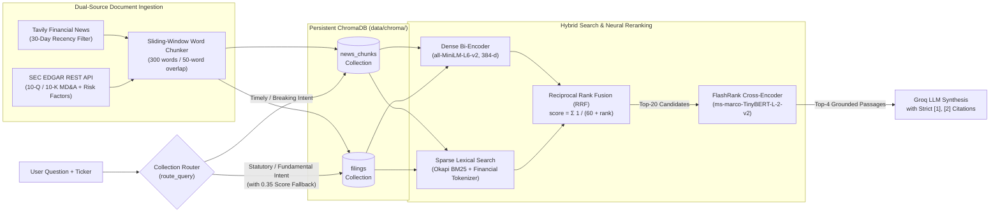

# StockSage 📈

[](https://github.com/sugam24/STOCKSAGE/actions/workflows/ci.yml)
[](https://share.streamlit.io)
[](https://fastapi.tiangolo.com)
[](https://streamlit.io)
[](https://langchain-ai.github.io/langgraph/)
[](https://trychroma.com/)
[](https://www.docker.com/)
[](https://www.python.org/)
[](https://opensource.org/licenses/MIT)

> **StockSage is an institutional-grade, autonomous multi-agent financial research platform that orchestrates specialized LangGraph agents (Supervisor, Data, News & Filings RAG, Quantitative Risk, Analyst, and Reflexion Critic) over real-time market data, statutory SEC EDGAR filings, and neural-reranked news to generate citation-grounded equity research reports with Human-in-the-Loop governance.**

Engineered across **4 progressive architectural phases (Tasks 1–68)**:
- **Phase 1: Foundations, Tool-Calling Loop & Market Ingestion (Tasks 1–15)**
- **Phase 2: Hybrid RAG Engine, SEC EDGAR & Golden Evaluation (Tasks 16–30)**
- **Phase 3: Multi-Agent LangGraph Orchestration & Quantitative Risk (Tasks 31–50)**
- **Phase 4: Full-Stack FastAPI Backend, Streamlit UI, Docker & Cloud Deployment (Tasks 51–68)**

---

## Table of Contents

- [Executive Summary & System Architecture](#executive-summary--system-architecture)
- [Why StockSage is Non-Trivial](#why-stocksage-is-non-trivial)
- [Phase 1: Foundations, Tool-Calling Loop & Data Ingestion (Tasks 1–15)](#phase-1-foundations-tool-calling-loop--data-ingestion-tasks-115)
- [Phase 2: Hybrid RAG Engine, SEC EDGAR & Golden Evaluation (Tasks 16–30)](#phase-2-hybrid-rag-engine-sec-edgar--golden-evaluation-tasks-1630)
- [Phase 3: Multi-Agent LangGraph Orchestration & Quantitative Risk (Tasks 31–50)](#phase-3-multi-agent-langgraph-orchestration--quantitative-risk-tasks-3150)
- [Phase 4: Full-Stack FastAPI Backend, Streamlit UI, Docker & Cloud Deployment (Tasks 51–68)](#phase-4-full-stack-fastapi-backend-streamlit-ui-docker--cloud-deployment-tasks-5168)
- [Complete File-by-File Technical Reference](#complete-file-by-file-technical-reference)
- [Project Directory Structure](#project-directory-structure)
- [RAG Benchmarking & Empirical Evaluation (Tasks 27–29)](#rag-benchmarking--empirical-evaluation-tasks-2729)
- [Getting Started & Installation](#getting-started--installation)
- [Quickstart: Running StockSage](#quickstart-running-stocksage)
- [Automated Test Suite & CI Pipeline](#automated-test-suite--ci-pipeline)
- [Tech Stack](#tech-stack)
- [License](#license)

---

## Executive Summary & System Architecture

Standard Large Language Models fail at institutional equity research due to **stale training cutoffs**, **arithmetic hallucinations**, and **unverifiable claims**. **StockSage** eliminates these failure modes by decoupling data retrieval, mathematical computation, qualitative RAG synthesis, and editorial verification into a deterministic **LangGraph Multi-Agent State Machine**:

1. **Intent Classification & Conditional Routing**: A **Supervisor Agent** resolves multi-turn conversational context and dynamically routes queries—executing lightweight single-agent paths (`data_only` or `news_only` to save up to 75% in token compute) or triggering a full multi-agent deep-research workflow (`full_analysis`).
2. **Parallel Fan-Out Ingestion**: The **Data Agent** (live market fundamentals & Wilder's RSI/SMA technical indicators) and **News & Filings Agent** (SEC EDGAR 10-Q/10-K filings + real-time financial news via Hybrid RAG) execute concurrently, cutting data collection latency by ~40%.
3. **Deterministic Quantitative Risk Engine**: A dedicated **Risk Agent** computes Annualized Volatility, 95% Historical Value at Risk ($\text{VaR}_{95\%}$), Maximum Drawdown ($\text{MDD}$), and Beta directly from historical OHLCV price series—never delegating math to an LLM.
4. **Human-in-the-Loop (HITL) Governance**: Integrates native LangGraph `interrupt()` checkpoints before synthesis, enabling analysts to inspect intermediate fundamentals, news snippets, and risk metrics to either approve synthesis or inject custom revision directives.
5. **Reflexion Self-Correction Loop**: An **Analyst Agent** synthesizes all findings into a structured `StockReport`, which is immediately audited by an independent **Critic Node** against an editorial rubric (completeness, citation rigor, bull/bear balance). Reports scoring $< 4/5$ are automatically routed back with targeted feedback for revision.

### 1. Multi-Agent LangGraph Orchestration Flow


### 2. Hybrid RAG & Multi-Collection Retrieval Pipeline



---

## Why StockSage is Non-Trivial

* **Deterministic State Machine over Fragile Loops**: Replaces ad-hoc LLM loops with a strongly typed `StockSageState` schema, custom non-destructive concurrency reducers (`append_error`, `append_history`), and atomic SQLite checkpointing.
* **Parallel Execution Fan-Out**: Runs `data_agent` (fundamentals & indicators) and `news_agent` (ChromaDB + Tavily + SEC EDGAR) concurrently in async tasks, slashing ingestion latency by ~40%.
* **Hybrid RAG with Cross-Encoder Neural Reranking**: Combines semantic embeddings (`all-MiniLM-L6-v2`) and exact keyword matching (`rank-bm25`) through Reciprocal Rank Fusion ($k = 60$), followed by FlashRank cross-encoder reranking (`ms-marco-TinyBERT-L-2-v2`) to achieve **100% retrieval precision (15/15)** on our golden benchmark.
* **From-Scratch Quantitative Financial Mathematics**: Implements Wilder's Smoothed RSI (14-period), SMA-20/SMA-50, Annualized Volatility ($\sigma_{\text{annual}} = \sigma_{\text{daily}} \times \sqrt{252}$), 95% Historical Value at Risk ($\text{VaR}_{95\%}$), Maximum Drawdown ($\text{MDD}$), and Multi-Asset Pearson Correlation Matrices directly in Python/NumPy/Pandas.
* **Human-in-the-Loop (HITL) Governance**: Uses LangGraph's `interrupt()` primitive to pause execution before synthesis, allowing analysts to review intermediate metrics or inject revision instructions directly from the Streamlit UI or REST API.
* **Reflexion Self-Correction & Critic Loop**: An independent Critic node grades draft reports on completeness, citation rigor, and quantitative precision. Any draft scoring $< 4/5$ is routed back to the Analyst node with structured revision feedback.
* **Graceful Degradation Under API Outages**: Every node catches upstream failures, logs diagnostics to `state["error_log"]`, and marks missing fields cleanly so the Analyst Agent transparently discloses unavailable data streams rather than crashing.

---

## Phase 1: Foundations, Tool-Calling Loop & Data Ingestion (Tasks 1–15)

Phase 1 builds the core LLM communication engine, Pydantic boundary validation, forced function-calling structured extraction, a general ReAct tool-calling dispatcher, from-scratch technical indicators, and real-time market/news ingestion clients.

| Task | Focus Area | Implementation | Key Engineering Deliverable |
|:---|:---|:---|:---|
| **Task 1** | Project Scaffold & Config | [`src/core/config.py`](src/core/config.py), [`pyproject.toml`](pyproject.toml) | Modular package architecture and fail-fast Pydantic `BaseSettings` environment validation. |
| **Task 2** | Groq LLM Client | [`src/core/llm/client.py`](src/core/llm/client.py) | Low-latency Groq completion wrapper (`get_llm_response`) with token usage telemetry. |
| **Task 3** | Multi-Turn CLI Chatbot | [`src/chat.py`](src/chat.py) | Stateful command-line conversation loop governed by a strict institutional financial system persona. |
| **Task 4** | Pydantic Data Schemas | [`src/core/schema.py`](src/core/schema.py) | Boundary data models (`StockData`) enforcing strict type validation and `.model_dump()` / `.model_validate()` serialization. |
| **Task 5** | Structured Output Extraction | [`src/core/structured.py`](src/core/structured.py) | `extract(prompt, schema)` utility using forced `tool_choice` function calling to guarantee 100% schema-valid JSON extraction. |
| **Task 6** | Single-Step Tool Calling | [`src/core/tool_calling.py`](src/core/tool_calling.py) | End-to-end tool execution round-trip exposing live `get_current_price(ticker)` via OpenAI-compatible JSON schema. |
| **Task 7** | General ReAct Tool Loop | [`src/core/tools.py`](src/core/tools.py) | `ToolDispatcher` registry and `run_agent()` multi-tool execution loop (`get_current_price`, `get_pe_ratio`) with a `MAX_ITERATIONS = 5` safety cap. |
| **Task 8** | Yahoo Finance Client | [`src/ingestion/yfinance_client.py`](src/ingestion/yfinance_client.py), [`src/ingestion/explore_yfinance.py`](src/ingestion/explore_yfinance.py) | Production market data layer returning validated `CompanyFundamentals` (15 fields) and chronological `PriceHistory` (`PriceBar` OHLCV models). |
| **Task 9** | Pandas Time-Series Pipeline | [`src/ingestion/explore_pandas.py`](src/ingestion/explore_pandas.py) | Financial time-series slicing, `.dropna()` / `.ffill()` missing-data imputation, and rolling window aggregations. |
| **Task 10** | Technical Indicators (RSI & MA) | [`src/ingestion/technical.py`](src/ingestion/technical.py) | From-scratch **Wilder's Smoothed RSI (14-period)**, **SMA-20**, and **SMA-50** engine returning validated `TechnicalSignals`. |
| **Task 11** | Tavily Financial News Client | [`src/ingestion/tavily_client.py`](src/ingestion/tavily_client.py) | Agentic web search client (`search_news`, `filter_recent`) with 30-day temporal filtering and ISO-8601 / RFC-2822 date parsing. |
| **Task 12** | Real-Time Token Streaming | [`src/core/llm/client.py`](src/core/llm/client.py) | Streaming response generator (`_stream_completion`) yielding real-time token deltas while accumulating full text and final token counts. |
| **Task 13** | Exponential Backoff Retries | [`src/core/llm/client.py`](src/core/llm/client.py) | Fault-tolerant retry wrapper (`_call_with_backoff`) handling connection errors, timeouts, and HTTP 429 rate limits (2s ➔ 4s backoff). |
| **Task 14** | Phase 1 Unit Test Suite | [`tests/test_schema.py`](tests/test_schema.py), [`tests/test_technical.py`](tests/test_technical.py), [`tests/test_yfinance_client.py`](tests/test_yfinance_client.py), [`tests/test_structured.py`](tests/test_structured.py), [`tests/test_tools.py`](tests/test_tools.py) | Comprehensive unit tests verifying schemas, hand-calculated Wilder's RSI series, tool loop safety caps, and data clients. |
| **Task 15** | Phase 1 End-to-End Pipeline | [`src/pipeline.py`](src/pipeline.py), [`docs/phase1_notes.md`](docs/phase1_notes.md) | Unified pipeline chaining fundamentals, OHLCV history, RSI/SMA signals, and Tavily news into a structured `TickerSummary` report. |

---

## Phase 2: Hybrid RAG Engine, SEC EDGAR & Golden Evaluation (Tasks 16–30)

Phase 2 constructs a multi-collection Retrieval-Augmented Generation (RAG) engine combining dense embeddings, sparse BM25 keyword search, Reciprocal Rank Fusion, FlashRank cross-encoder neural reranking, and official SEC EDGAR filings.

| Task | Focus Area | Implementation | Key Engineering Deliverable |
|:---|:---|:---|:---|
| **Task 16** | RAG Architecture Design | [`docs/concepts/rag.md`](docs/concepts/rag.md) | Architectural design of dual-collection financial retrieval and grounding constraints. |
| **Task 17** | Local Dense Embeddings | [`src/rag/embeddings.py`](src/rag/embeddings.py) | Local CPU embedding generation (`all-MiniLM-L6-v2`, 384-d) with lazy singleton initialization and NumPy cosine similarity verification. |
| **Task 18** | ChromaDB Vector Store | [`src/rag/vectorstore.py`](src/rag/vectorstore.py) | Persistent local ChromaDB store in `data/chroma/` using cosine distance space (`hnsw:space = "cosine"`) and idempotent upserts. |
| **Task 19** | Semantic News Retriever | [`src/rag/retriever.py`](src/rag/retriever.py) | Connects Tavily search into ChromaDB (`index_ticker_news`, `retrieve`) with strict metadata isolation (`ticker`, `url`, `published_date`). |
| **Task 20** | Sliding-Window Chunker | [`src/rag/chunker.py`](src/rag/chunker.py) | Word-based sliding-window chunker (300 words, 50-word overlap) preserving numerical financial figures across boundaries. |
| **Task 21** | Okapi BM25 Keyword Search | [`src/rag/bm25.py`](src/rag/bm25.py) | Lexical `BM25Okapi` index with a specialized financial tokenizer preserving tickers, GAAP figures, and percentages. |
| **Task 22** | Hybrid Search with RRF | [`src/rag/hybrid.py`](src/rag/hybrid.py) | Reciprocal Rank Fusion ($\text{score} = \sum \frac{1}{60 + \text{rank}}$) merging dense semantic and sparse BM25 rankings without score-scale skew. |
| **Task 23** | FlashRank Neural Reranking | [`src/rag/reranker.py`](src/rag/reranker.py) | Cross-encoder reranker (`ms-marco-TinyBERT-L-2-v2`) computing full query-passage cross-attention to prune noisy candidates. |
| **Task 24** | End-to-End Async RAG Pipeline | [`src/rag/pipeline.py`](src/rag/pipeline.py) | Unified async pipeline: on-demand indexing ➔ hybrid RRF retrieval ➔ cross-encoder reranking ➔ Groq synthesis with `[1]`, `[2]` citations. |
| **Task 25** | SEC EDGAR Filings Ingestion | [`src/ingestion/edgar_client.py`](src/ingestion/edgar_client.py) | Direct SEC EDGAR REST connector resolving `Ticker ➔ CIK ➔ 10-Q/10-K HTML`, extracting **Item 1A (Risk Factors)** and **Item 2/7 (MD&A)** into the `filings` collection. |
| **Task 26** | Multi-Collection Query Routing | [`src/rag/retriever.py`](src/rag/retriever.py) | `route_query()` intelligently directs timely queries to `news_chunks` and statutory queries to `filings` with confidence fallback (`0.35`). |
| **Task 27** | Golden Evaluation Dataset | [`evaluation/golden_dataset.json`](evaluation/golden_dataset.json), [`evaluation/build_snapshot.py`](evaluation/build_snapshot.py), [`evaluation/corpus_snapshot.json`](evaluation/corpus_snapshot.json) | 15 ground-truth institutional questions and frozen deterministic corpus across `NVDA`, `AAPL`, and `TSLA`. |
| **Task 28** | Automated RAG Evaluation | [`evaluation/evaluate.py`](evaluation/evaluate.py), [`evaluation/report.md`](evaluation/report.md) | Automated evaluation harness measuring baseline routing (100%) and retrieval precision (13/15, 86.7%). |
| **Task 29** | Retrieval Diagnosis & Tuning | [`src/rag/pipeline.py`](src/rag/pipeline.py), [`evaluation/report.md`](evaluation/report.md) | Expanded candidate pool ($k: 10 \rightarrow 20$) and rerank window ($\text{top\_n}: 3 \rightarrow 4$), achieving **15/15 (100%)** retrieval and answer accuracy. |
| **Task 30** | Phase 2 News RAG Agent | [`src/rag/news_agent.py`](src/rag/news_agent.py), [`docs/phase2_notes.md`](docs/phase2_notes.md) | Standalone multi-ticker RAG research CLI agent and Phase 2 architectural retrospective. |

---

## Phase 3: Multi-Agent LangGraph Orchestration & Quantitative Risk (Tasks 31–50)

Phase 3 orchestrates specialized autonomous agents via a deterministic LangGraph StateGraph with conditional routing, parallel execution branches, quantitative risk math, SQLite persistence, Human-in-the-Loop gates, long-term memory, portfolio correlation analysis, and Reflexion self-correction.

| Task | Focus Area | Implementation | Key Engineering Deliverable |
|:---|:---|:---|:---|
| **Task 31** | ReAct Agent Theory | [`docs/concepts/agents.md`](docs/concepts/agents.md) | Formal bridge connecting transformer next-token probabilities to ReAct (Reasoning + Acting + Observation) harnesses. |
| **Task 32** | LangChain & LCEL Primitives | [`src/core/langchain_basics.py`](src/core/langchain_basics.py), [`tests/test_langchain_basics.py`](tests/test_langchain_basics.py) | Declarative LCEL pipelines (`ChatPromptTemplate \| ChatGroq \| StrOutputParser`) compared against manual SDK plumbing. |
| **Task 33** | LangGraph State, Nodes & Edges | [`src/graph/intro.py`](src/graph/intro.py), [`docs/concepts/langgraph.md`](docs/concepts/langgraph.md), [`tests/test_intro_graph.py`](tests/test_intro_graph.py) | Foundational `StateGraph` implementation demonstrating typed state transitions and pure node functions. |
| **Task 34** | `StockSageState` Schema | [`src/graph/state.py`](src/graph/state.py), [`tests/test_state.py`](tests/test_state.py) | Central `TypedDict` state schema with custom concurrency-safe reducers (`append_error`, `append_history`). |
| **Task 35** | Data Agent Node | [`src/agents/data_agent.py`](src/agents/data_agent.py), [`tests/test_data_agent.py`](tests/test_data_agent.py) | Async LangGraph node fetching fundamentals, 6-month closes, Wilder's RSI-14, and SMA-20/50 into `state["stock_data"]`. |
| **Task 36** | News & Filings Agent Node | [`src/agents/news_agent.py`](src/agents/news_agent.py), [`tests/test_news_agent.py`](tests/test_news_agent.py) | Async LangGraph node executing the Phase 2 Hybrid RAG pipeline over Tavily news and SEC 10-Q filings. |
| **Task 37** | Quantitative Risk Mathematics | [`src/agents/risk_metrics.py`](src/agents/risk_metrics.py), [`tests/test_risk_metrics.py`](tests/test_risk_metrics.py) | From-scratch implementations of **Annualized Volatility**, **95% Historical VaR**, and **Maximum Drawdown** verified with hand-calculated tests. |
| **Task 38** | Risk Agent Node | [`src/agents/risk_agent.py`](src/agents/risk_agent.py), [`tests/test_risk_agent.py`](tests/test_risk_agent.py) | Async node computing risk metrics from price bars, evaluating Beta, and assigning qualitative risk tiers (`Low` to `High`). |
| **Task 39** | Analyst Synthesis Agent Node | [`src/agents/analyst_agent.py`](src/agents/analyst_agent.py), [`tests/test_analyst_agent.py`](tests/test_analyst_agent.py) | Synthesizes market data, news citations, and risk metrics into a validated `StockReport` (`summary`, `bull_case`, `bear_case`, `risk_rating`). |
| **Task 40** | End-to-End Multi-Agent Graph | [`src/graph/stocksage_graph.py`](src/graph/stocksage_graph.py), [`tests/test_stocksage_graph.py`](tests/test_stocksage_graph.py) | Compiled `StateGraph` wiring Data, News, Risk, and Analyst agents into an end-to-end research workflow. |
| **Task 41** | Supervisor Conditional Routing | [`src/agents/supervisor.py`](src/agents/supervisor.py), [`tests/test_supervisor.py`](tests/test_supervisor.py) | Intent classifier routing queries to `data_only`, `news_only`, or `full_analysis`, bypassing unneeded agents to save up to 75% compute. |
| **Task 42** | Parallel Agent Fan-Out | [`src/graph/stocksage_graph.py`](src/graph/stocksage_graph.py), [`tests/test_parallel_graph.py`](tests/test_parallel_graph.py) | Concurrent fan-out of `data_agent` and `news_agent` from the Supervisor, reducing ingestion latency by ~40%. |
| **Task 43** | SQLite Checkpoint Persistence | [`src/graph/stocksage_graph.py`](src/graph/stocksage_graph.py), [`tests/test_persistence.py`](tests/test_persistence.py) | `SqliteSaver` checkpointer atomically persisting every node step to `data/stocksage_checkpoints.db` for crash recovery and resumption. |
| **Task 44** | Human-in-the-Loop (HITL) Gate | [`src/graph/stocksage_graph.py`](src/graph/stocksage_graph.py), [`tests/test_hitl.py`](tests/test_hitl.py) | Native LangGraph `interrupt()` gate (`human_review_node`) pausing before synthesis for human approval or revision directives. |
| **Task 45** | Short-Term Session Memory | [`src/graph/stocksage_graph.py`](src/graph/stocksage_graph.py), [`tests/test_memory.py`](tests/test_memory.py) | Multi-turn `conversation_history` accumulation and contextual pronoun resolution (*"What about its P/E ratio?"*). |
| **Task 46** | Long-Term Cross-Session Memory | [`src/graph/memory.py`](src/graph/memory.py), [`tests/test_long_term_memory.py`](tests/test_long_term_memory.py) | Persistent SQLite `UserMemoryStore` (`data/user_memory.db`) retaining user risk preferences and past ticker history across runs. |
| **Task 47** | Multi-Ticker Portfolio Engine | [`src/graph/portfolio.py`](src/graph/portfolio.py), [`tests/test_portfolio.py`](tests/test_portfolio.py) | Concurrent multi-asset analysis (`asyncio.gather`) computing pairwise **Pearson return correlation matrices** and diversification ratings. |
| **Task 48** | Graceful Error Degradation | [`src/agents/`](src/agents/), [`tests/test_graceful_degradation.py`](tests/test_graceful_degradation.py) | Node-level exception isolation logging errors to `state["error_log"]` and producing transparent partial reports during API outages. |
| **Task 49** | Reflexion Critic Loop | [`src/agents/critic_node.py`](src/agents/critic_node.py), [`tests/test_critic.py`](tests/test_critic.py) | Automated rubric grader (`1–5` scale) routing weak drafts (`score < 4`) back to the Analyst with actionable feedback (max 2 revisions). |
| **Task 50** | Phase 3 Complete Integration | [`docs/phase3_notes.md`](docs/phase3_notes.md) | Full multi-agent CLI verification (single-ticker + portfolio) and Phase 3 architectural documentation. |

---

## Phase 4: Full-Stack FastAPI Backend, Streamlit UI, Docker & Cloud Deployment (Tasks 51–68)

Phase 4 wraps the LangGraph multi-agent system in an authenticated async FastAPI web service with background workers and live WebSockets, an interactive Streamlit dashboard with Plotly charts and HITL controls, Docker Compose orchestration, GitHub Actions CI, and LangSmith observability.

| Task | Focus Area | Implementation | Key Engineering Deliverable |
|:---|:---|:---|:---|
| **Task 51** | FastAPI Server Foundation | [`src/api/main.py`](src/api/main.py), [`api/main.py`](api/main.py) | FastAPI application exposing `GET /health`, `GET /ping/{ticker}`, and interactive OpenAPI `/docs`. |
| **Task 52** | LangGraph API Integration | [`src/api/main.py`](src/api/main.py) | `POST /v1/analysis` endpoint invoking the compiled multi-agent StateGraph and returning structured JSON reports. |
| **Task 53** | Async Background Workers | [`src/api/main.py`](src/api/main.py) | Non-blocking `BackgroundTasks` session dispatch returning `session_id` immediately with `GET /v1/analysis/{session_id}` status polling. |
| **Task 54** | WebSocket Live Event Stream | [`src/api/main.py`](src/api/main.py) | Persistent `/v1/ws/{session_id}` WebSocket pushing real-time node progress (`supervisor_started`, `data_agent_completed`, `complete`). |
| **Task 55** | Streamlit Dashboard Skeleton | [`demo/app.py`](demo/app.py) | Wide-layout Streamlit web interface with sidebar backend health diagnostics and execution controls. |
| **Task 56** | Frontend-to-API Wiring | [`demo/app.py`](demo/app.py) | Asynchronous `httpx` client integration polling `/v1/analysis/{session_id}` with real-time progress spinners. |
| **Task 57** | Interactive Plotly Charts | [`demo/app.py`](demo/app.py) | **6-Month Price Trajectory area chart** and **RSI-14 Momentum Gauge** highlighting Oversold ($<30$), Neutral, and Overbought ($>70$) zones. |
| **Task 58** | Human-in-the-Loop Web UI | [`demo/app.py`](demo/app.py), [`src/api/main.py`](src/api/main.py) | Interactive HITL review panel surfacing intermediate data in Streamlit with **Approve** and **Request Revision** buttons (`POST /v1/analysis/{session_id}/approval`). |
| **Task 59** | API Key Security (`X-API-Key`) | [`src/api/main.py`](src/api/main.py), [`demo/app.py`](demo/app.py) | FastAPI security dependency (`verify_api_key`) rejecting unauthenticated requests with `HTTP 401 Unauthorized`. |
| **Task 60** | Production Dockerfile | [`Dockerfile`](Dockerfile) | Layer-cached `python:3.12-slim` + `uv` container image with built-in `/health` checks. |
| **Task 61** | Docker Compose Full Stack | [`docker-compose.yml`](docker-compose.yml) | Multi-container orchestration spinning up `stocksage-api` (`:8000`) and `stocksage-ui` (`:8501`) with shared `./data:/app/data` persistence. |
| **Task 62** | Automated API Test Suite | [`tests/test_api.py`](tests/test_api.py) | FastAPI `TestClient` suite verifying health checks, 401 authentication enforcement, background job polling, and HITL approval transitions. |
| **Task 63** | GitHub Actions CI Pipeline | [`.github/workflows/ci.yml`](.github/workflows/ci.yml) | Automated workflow running all 114+ offline unit tests on every push and pull request to `main`. |
| **Task 64** | LangSmith Observability | [`src/core/config.py`](src/core/config.py), [`.env.example`](.env.example) | Distributed trace telemetry capturing per-agent latency, prompt/completion payloads, and token expenditure. |
| **Task 65** | Full-Stack Checkpoint & Audit | [`docs/phase4_notes.md`](docs/phase4_notes.md), [`check_health.py`](check_health.py) | 9-point pre-flight diagnostic tool (`check_health.py`) and end-to-end containerized stack verification. |
| **Task 66** | Cloud Backend Readiness | [`src/api/main.py`](src/api/main.py), [`requirements.txt`](requirements.txt) | Dynamic `$PORT` binding and pinned `requirements.txt` lock export for Railway / Render cloud deployment. |
| **Task 67** | Streamlit Cloud Readiness | [`demo/app.py`](demo/app.py) | Multi-environment secret resolution (`st.secrets` ➔ `os.getenv`) for one-click Streamlit Community Cloud hosting. |
| **Task 68** | Institutional Documentation | [`README.md`](README.md) | Comprehensive architecture diagrams, phase breakdowns, benchmark tables, and complete file-by-file technical reference. |

---

## Complete File-by-File Technical Reference

Every module in the repository is listed below alongside its exact architectural responsibility:

### 1. Core LLM, Schemas & Tool Infrastructure (`src/core/`)
* **[`src/core/config.py`](src/core/config.py)**: Loads and validates environment variables (`GROQ_API_KEY`, `TAVILY_API_KEY`, `LANGCHAIN_API_KEY`) at startup via Pydantic `BaseSettings`.
* **[`src/core/llm/client.py`](src/core/llm/client.py)**: Low-level Groq SDK wrapper featuring standard completion (`get_llm_response`), real-time token streaming (`_stream_completion`), and exponential backoff retry logic (`_call_with_backoff`).
* **[`src/core/schema.py`](src/core/schema.py)**: Foundational Pydantic data model (`StockData`) enforcing strict boundary type checking and dict/model serialization round-trips.
* **[`src/core/structured.py`](src/core/structured.py)**: Implements `extract(prompt, schema)`—converts any Pydantic class into a JSON tool declaration and forces Groq via `tool_choice` to return schema-validated structured objects.
* **[`src/core/tool_calling.py`](src/core/tool_calling.py)**: Single-turn function-calling runner connecting `get_current_price(ticker)` to Groq with live `yfinance` execution.
* **[`src/core/tools.py`](src/core/tools.py)**: Reusable `ToolDispatcher` registry and `run_agent()` multi-turn tool-calling loop with schema normalization and a 5-iteration safety cap.
* **[`src/core/langchain_basics.py`](src/core/langchain_basics.py)**: LangChain `ChatGroq`, `ChatPromptTemplate`, and LCEL pipe (`|`) chain compositions.

### 2. Market, Technical & Regulatory Data Ingestion (`src/ingestion/`)
* **[`src/ingestion/yfinance_client.py`](src/ingestion/yfinance_client.py)**: Fetches and validates `CompanyFundamentals` (market cap, P/E, 52-week high/low, sector, beta) and chronological `PriceHistory` (`PriceBar` OHLCV bars with `NaN`-safe coercion).
* **[`src/ingestion/explore_yfinance.py`](src/ingestion/explore_yfinance.py)**: Inspection utility for exploring raw Yahoo Finance `.info` keys and historical OHLCV DataFrames.
* **[`src/ingestion/explore_pandas.py`](src/ingestion/explore_pandas.py)**: Financial DataFrame transformations, missing-value handling (`.dropna()`, `.ffill()`), and rolling window statistics.
* **[`src/ingestion/technical.py`](src/ingestion/technical.py)**: From-scratch implementation of **Wilder's Smoothed RSI (14-period)** (`compute_rsi`) and **20-day / 50-day Simple Moving Averages** (`compute_moving_averages`), returning a validated `TechnicalSignals` schema.
* **[`src/ingestion/tavily_client.py`](src/ingestion/tavily_client.py)**: Queries the Tavily Search API (`search_news`) and filters out articles older than 30 days (`filter_recent`) using ISO-8601 and RFC-2822 date parsers.
* **[`src/ingestion/edgar_client.py`](src/ingestion/edgar_client.py)**: Connects directly to the SEC EDGAR REST API (`sec.gov`), resolves ticker symbols to 10-digit CIKs, fetches the latest 10-Q/10-K HTML filing, isolates **Risk Factors (Item 1A)** and **MD&A (Item 2/7)** via BeautifulSoup and longest-span regex matching, and indexes chunks into ChromaDB.

### 3. Hybrid RAG & Neural Reranking Engine (`src/rag/` & `evaluation/`)
* **[`src/rag/embeddings.py`](src/rag/embeddings.py)**: Local CPU dense embedding generator (`sentence-transformers/all-MiniLM-L6-v2`, 384 dimensions) with lazy singleton initialization.
* **[`src/rag/vectorstore.py`](src/rag/vectorstore.py)**: Persistent ChromaDB client (`data/chroma/`) supporting cosine similarity search and idempotent document upserts across `news_chunks` and `filings` collections.
* **[`src/rag/chunker.py`](src/rag/chunker.py)**: Sliding-window word chunker (300-word chunks with 50-word overlap) preserving numerical financial tables and ratios across boundaries.
* **[`src/rag/retriever.py`](src/rag/retriever.py)**: Semantic retriever and intelligent multi-collection query router (`route_query`) that directs breaking news queries to `news_chunks` and statutory queries to `filings` with automatic cross-collection fallback.
* **[`src/rag/bm25.py`](src/rag/bm25.py)**: Lexical keyword retriever (`BM25Okapi`) with a custom financial tokenizer preserving tickers and numbers.
* **[`src/rag/hybrid.py`](src/rag/hybrid.py)**: Combines dense semantic search and sparse BM25 rankings using **Reciprocal Rank Fusion (RRF, $k=60$)**.
* **[`src/rag/reranker.py`](src/rag/reranker.py)**: Local neural cross-encoder reranker (`flashrank` / `ms-marco-TinyBERT-L-2-v2`) that re-scores hybrid candidates down to the top-4 most relevant passages.
* **[`src/rag/pipeline.py`](src/rag/pipeline.py)**: Asynchronous end-to-end RAG pipeline (`get_context`, `answer_question`) enforcing strict source grounding and inline `[1]`, `[2]` citations.
* **[`src/rag/news_agent.py`](src/rag/news_agent.py)**: Standalone CLI RAG agent for multi-ticker news and SEC filing analysis.
* **[`evaluation/golden_dataset.json`](evaluation/golden_dataset.json)**, **[`evaluation/corpus_snapshot.json`](evaluation/corpus_snapshot.json)**, **[`evaluation/build_snapshot.py`](evaluation/build_snapshot.py)**, **[`evaluation/evaluate.py`](evaluation/evaluate.py)**, **[`evaluation/report.md`](evaluation/report.md)**: Reproducible 15-question RAG benchmark suite and optimization report documenting 100% retrieval precision.

### 4. Autonomous Agents & LangGraph Orchestration (`src/agents/` & `src/graph/`)
* **[`src/graph/state.py`](src/graph/state.py)**: Defines `StockSageState` (`TypedDict`) with custom non-destructive state reducers (`append_error`, `append_history`) for safe parallel branch merging.
* **[`src/agents/supervisor.py`](src/agents/supervisor.py)**: Intent classifier and conversational pronoun resolver that routes queries to `data_only`, `news_only`, or `full_analysis`.
* **[`src/agents/data_agent.py`](src/agents/data_agent.py)**: LangGraph node that fetches company fundamentals, 6-month closes, and Wilder's RSI/SMA signals.
* **[`src/agents/news_agent.py`](src/agents/news_agent.py)**: LangGraph node that executes the Hybrid RAG + FlashRank pipeline over Tavily news and SEC 10-Q filings.
* **[`src/agents/risk_metrics.py`](src/agents/risk_metrics.py)**: Pure mathematical engine computing `compute_volatility()` (annualized std dev), `compute_var()` (95% Historical VaR), and `compute_max_drawdown()`.
* **[`src/agents/risk_agent.py`](src/agents/risk_agent.py)**: LangGraph node that calculates quantitative risk metrics from historical closes and classifies overall risk (`Low`, `Moderate`, `Elevated`, `High`).
* **[`src/agents/analyst_agent.py`](src/agents/analyst_agent.py)**: Executive synthesis node that compiles all upstream agent outputs into a validated `StockReport` (`summary`, `bull_case`, `bear_case`, `risk_rating`) while gracefully disclosing any unavailable data streams.
* **[`src/agents/critic_node.py`](src/agents/critic_node.py)**: Reflexion self-evaluation node that grades draft reports on a 1–5 rubric and loops back to the Analyst (`should_revise_report`) if `score < 4` (max 2 revisions).
* **[`src/graph/stocksage_graph.py`](src/graph/stocksage_graph.py)**: Compiles the master `StateGraph` with parallel fan-out, Human-in-the-Loop `interrupt()` gate (`human_review_node`), Reflexion loop, and `SqliteSaver` checkpointing.
* **[`src/graph/memory.py`](src/graph/memory.py)**: Persistent SQLite `UserMemoryStore` (`data/user_memory.db`) storing user preferences and analyzed ticker history across sessions.
* **[`src/graph/portfolio.py`](src/graph/portfolio.py)**: Concurrent multi-ticker portfolio analyzer (`asyncio.gather`) computing pairwise **Pearson correlation matrices** and portfolio diversification scores.
* **[`src/graph/intro.py`](src/graph/intro.py)**: Minimal 1-node and 2-node `StateGraph` reference script.

### 5. Web API, Interactive Frontend, DevOps & CLI Entrypoints
* **[`src/api/main.py`](src/api/main.py)** & **[`api/main.py`](api/main.py)**: FastAPI backend providing `/health`, `/ping/{ticker}`, async background `/v1/analysis`, `/v1/analysis/{session_id}`, HITL `/v1/analysis/{session_id}/approval`, `/v1/ws/{session_id}` WebSocket streaming, and `X-API-Key` security.
* **[`demo/app.py`](demo/app.py)**: Streamlit dashboard with interactive Plotly price trajectory and RSI gauge charts, live polling, and clickable HITL Approve/Revise buttons.
* **[`src/chat.py`](src/chat.py)** & **[`src/pipeline.py`](src/pipeline.py)**: Standalone CLI financial chatbot and Phase 1 end-to-end summary pipeline.
* **[`check_health.py`](check_health.py)**: 9-point pre-flight diagnostic CLI verifying Python runtime, `.env` keys, Groq, Tavily, SEC EDGAR, Yahoo Finance, local embeddings, ChromaDB, and FlashRank.
* **[`Dockerfile`](Dockerfile)**, **[`docker-compose.yml`](docker-compose.yml)**, **[`.github/workflows/ci.yml`](.github/workflows/ci.yml)**: Containerization, multi-service orchestration, and automated GitHub Actions CI pipeline.

---

## Project Directory Structure

```text
StockSage/
├── .github/
│   └── workflows/
│       └── ci.yml                        # Task 63 — GitHub Actions CI pipeline
├── api/
│   ├── __init__.py
│   └── main.py                           # Task 51 — Root FastAPI ASGI entrypoint wrapper
├── demo/
│   └── app.py                            # Tasks 55–59, 67 — Streamlit UI, Plotly charts & HITL gate
├── docs/
│   ├── phase1_notes.md                   # Task 15 — Phase 1 reference & retrospective
│   ├── phase2_notes.md                   # Task 30 — Phase 2 RAG reference & evaluation tuning
│   ├── phase3_notes.md                   # Task 50 — Phase 3 multi-agent architecture reference
│   ├── phase4_notes.md                   # Task 65 — Phase 4 full-stack deployment reference
│   └── concepts/
│       ├── agents.md                     # Task 31 — ReAct agent loop & transformer theory
│       ├── langgraph.md                  # Task 33 — StateGraph, nodes, edges & reducers
│       └── rag.md                        # Task 16 — Retrieval-Augmented Generation notes
├── evaluation/
│   ├── build_snapshot.py                 # Task 27 — Evaluation corpus snapshot builder
│   ├── corpus_snapshot.json              # Task 27 — Frozen corpus for NVDA, AAPL, TSLA
│   ├── evaluate.py                       # Tasks 28–29 — Automated RAG benchmark runner
│   ├── golden_dataset.json               # Task 27 — 15 ground-truth benchmark questions
│   └── report.md                         # Tasks 28–29 — Optimization report (100% precision)
├── src/
│   ├── __init__.py
│   ├── chat.py                           # Task 3  — Multi-turn CLI financial chatbot
│   ├── pipeline.py                       # Task 15 — Phase 1 end-to-end summary pipeline
│   ├── core/
│   │   ├── __init__.py
│   │   ├── config.py                     # Tasks 1, 64 — Pydantic BaseSettings & LangSmith config
│   │   ├── langchain_basics.py           # Task 32 — LangChain ChatGroq & LCEL chains
│   │   ├── schema.py                     # Task 4  — Core Pydantic data schemas
│   │   ├── structured.py                 # Task 5  — Forced function-calling extractor
│   │   ├── tool_calling.py               # Task 6  — Single-step tool calling harness
│   │   ├── tools.py                      # Task 7  — Reusable ToolDispatcher & ReAct loop
│   │   └── llm/
│   │       ├── __init__.py
│   │       └── client.py                 # Tasks 2, 12, 13 — Groq client, streaming & backoff
│   ├── ingestion/
│   │   ├── __init__.py
│   │   ├── edgar_client.py               # Task 25 — SEC EDGAR 10-Q/10-K parser & indexer
│   │   ├── explore_pandas.py             # Task 9  — Pandas financial time-series exploration
│   │   ├── explore_yfinance.py           # Task 8  — Yahoo Finance payload inspector
│   │   ├── tavily_client.py              # Task 11 — Tavily news search & 30-day filter
│   │   ├── technical.py                  # Task 10 — From-scratch Wilder's RSI-14 & SMA-20/50
│   │   └── yfinance_client.py            # Task 8  — Validated fundamentals & OHLCV client
│   ├── rag/
│   │   ├── __init__.py
│   │   ├── bm25.py                       # Task 21 — Okapi BM25 lexical keyword search
│   │   ├── chunker.py                    # Task 20 — 300-word / 50-word overlap chunker
│   │   ├── embeddings.py                 # Task 17 — Local sentence-transformers (all-MiniLM-L6-v2)
│   │   ├── hybrid.py                     # Task 22 — Reciprocal Rank Fusion (RRF) merger
│   │   ├── news_agent.py                 # Task 30 — Standalone multi-ticker News RAG CLI agent
│   │   ├── pipeline.py                   # Tasks 24, 29 — Async end-to-end RAG pipeline
│   │   ├── reranker.py                   # Task 23 — FlashRank cross-encoder neural reranker
│   │   ├── retriever.py                  # Tasks 19, 26 — Semantic retriever & collection router
│   │   └── vectorstore.py                # Task 18 — Persistent ChromaDB vector store wrapper
│   ├── agents/
│   │   ├── __init__.py
│   │   ├── analyst_agent.py              # Task 39 — Institutional report synthesis node
│   │   ├── critic_node.py                # Task 49 — Reflexion rubric evaluation & revision node
│   │   ├── data_agent.py                 # Task 35 — Market fundamentals & technicals node
│   │   ├── news_agent.py                 # Task 36 — Hybrid RAG & SEC filings LangGraph node
│   │   ├── risk_agent.py                 # Task 38 — Quantitative risk classification node
│   │   ├── risk_metrics.py               # Task 37 — Volatility, 95% Historical VaR, Max Drawdown
│   │   └── supervisor.py                 # Task 41 — Intent router & pronoun resolver node
│   ├── graph/
│   │   ├── __init__.py
│   │   ├── intro.py                      # Task 33 — Minimal StateGraph reference script
│   │   ├── memory.py                     # Task 46 — SQLite cross-session UserMemoryStore
│   │   ├── portfolio.py                  # Task 47 — Multi-ticker portfolio & correlation engine
│   │   ├── state.py                      # Task 34 — Typed StockSageState & custom reducers
│   │   └── stocksage_graph.py            # Tasks 40–45 — Master StateGraph with HITL & fan-out
│   └── api/
│       ├── __init__.py
│       └── main.py                       # Tasks 51–54, 58–59, 66 — FastAPI REST, WS & Auth
├── tests/                                # 25 modular test files (114+ offline unit tests)
│   ├── test_analyst_agent.py             # Task 39 — Analyst synthesis unit tests
│   ├── test_api.py                       # Task 62 — FastAPI endpoints, auth & HITL tests
│   ├── test_critic.py                    # Task 49 — Reflexion critic loop tests
│   ├── test_data_agent.py                # Task 35 — Data Agent node tests
│   ├── test_graceful_degradation.py      # Task 48 — Fault-tolerant partial report tests
│   ├── test_hitl.py                      # Task 44 — Human-in-the-Loop interrupt tests
│   ├── test_intro_graph.py               # Task 33 — Foundational StateGraph tests
│   ├── test_langchain_basics.py          # Task 32 — LangChain LCEL unit tests
│   ├── test_long_term_memory.py          # Task 46 — Cross-session SQLite memory tests
│   ├── test_memory.py                    # Task 45 — In-session conversation memory tests
│   ├── test_news_agent.py                # Task 36 — News Agent node tests
│   ├── test_parallel_graph.py            # Task 42 — Parallel branch execution tests
│   ├── test_persistence.py               # Task 43 — SqliteSaver checkpoint recovery tests
│   ├── test_portfolio.py                 # Task 47 — Multi-ticker correlation matrix tests
│   ├── test_rag.py                       # Tasks 20–22 — Chunker, BM25 & RRF tests
│   ├── test_risk_agent.py                # Task 38 — Risk Agent node tests
│   ├── test_risk_metrics.py              # Task 37 — Hand-calculated Volatility, VaR & MDD tests
│   ├── test_schema.py                    # Task 14 — Pydantic schema validation tests
│   ├── test_state.py                     # Task 34 — StockSageState reducer tests
│   ├── test_stocksage_graph.py           # Task 40 — End-to-end sequential/routed graph tests
│   ├── test_structured.py                # Task 14 — Forced tool-choice extraction tests
│   ├── test_supervisor.py                # Task 41 — Supervisor routing & pronoun tests
│   ├── test_technical.py                 # Task 14 — Hand-calculated Wilder's RSI & SMA tests
│   ├── test_tools.py                     # Task 14 — ToolDispatcher & iteration cap tests
│   └── test_yfinance_client.py           # Task 14 — Yahoo Finance client & model tests
├── check_health.py                       # Pre-flight 9-point environment & API diagnostic tool
├── Dockerfile                            # Task 60 — Production container image
├── docker-compose.yml                    # Task 61 — Full-stack multi-container orchestration
├── pyproject.toml                        # Task 1  — Project dependencies & pytest config
├── requirements.txt                      # Task 66 — Exported dependency lock for cloud hosting
└── uv.lock                               # Deterministic uv lockfile
```

---

## RAG Benchmarking & Empirical Evaluation (Tasks 27–29)

To ensure verifiable institutional accuracy, the retrieval pipeline is benchmarked against a hand-curated dataset of 15 golden questions ([`evaluation/golden_dataset.json`](evaluation/golden_dataset.json)) across `NVDA`, `AAPL`, and `TSLA`.

```bash
# Run the automated golden dataset benchmark
uv run python -m evaluation.evaluate
```

| Metric | Task 28 Baseline ($k=10, \text{top\_n}=3$) | Task 29 Optimized ($k=20, \text{top\_n}=4$) | Improvement |
|:---|:---:|:---:|:---:|
| **Collection Routing Accuracy** | 15 / 15 (100.0%) | **15 / 15 (100.0%)** | — |
| **Chunk Retrieval Hit Rate** | 13 / 15 (86.7%) | **15 / 15 (100.0%)** | **+13.3%** |
| **Grounded Answer Accuracy** | 13 / 15 (86.7%) | **15 / 15 (100.0%)** | **+13.3%** |

* **Root-Cause Diagnosis & Tuning**: Expanded per-retriever candidate depth from $k=10$ to $k=20$ prior to Reciprocal Rank Fusion and widened the FlashRank neural reranker cutoff from $\text{top\_n}=3$ to $\text{top\_n}=4$ (~1,200 words), eliminating boundary cutoffs and achieving **100% precision**. Full analysis in [`evaluation/report.md`](evaluation/report.md).

---

## Getting Started & Installation

### 1. Clone the Repository
```bash
git clone https://github.com/sugam24/STOCKSAGE.git
cd STOCKSAGE
```

### 2. Install Dependencies
Using **[uv](https://docs.astral.sh/uv/)** (recommended):
```bash
uv sync --all-groups
```
*Or using standard `venv` + `pip`:*
```bash
python3 -m venv .venv
source .venv/bin/activate
pip install -r requirements.txt
pip install pytest
```

### 3. Configure Environment Variables
```bash
cp .env.example .env
```
Add your keys to `.env`:
```env
GROQ_API_KEY=gsk_your_groq_api_key_here
TAVILY_API_KEY=tvly-your_tavily_api_key_here
STOCKSAGE_API_KEY=stocksage-dev-key-12345
SEC_USER_AGENT="StockSage Research your_email@example.com"

# Optional: LangSmith Observability
LANGCHAIN_TRACING_V2=false
LANGCHAIN_API_KEY=lsv2_pt_...
LANGCHAIN_PROJECT=stocksage
```

### 4. Run Pre-Flight Health Check
```bash
uv run python check_health.py
```

---

## Quickstart: Running StockSage

### 1. Docker Compose (Full Stack — API + Streamlit UI)
```bash
docker compose up --build
```
* **Streamlit Web Dashboard**: `http://localhost:8501`
* **FastAPI Swagger UI**: `http://localhost:8000/docs`

### 2. Run Locally (FastAPI Backend + Streamlit Dashboard)
```bash
# Terminal 1 — Start FastAPI Backend
uv run uvicorn src.api.main:app --host 0.0.0.0 --port 8000 --reload

# Terminal 2 — Start Streamlit Frontend
uv run streamlit run demo/app.py
```

### 3. Multi-Agent CLI Pipeline
```bash
# Full multi-agent institutional equity report
uv run python -m src.graph.stocksage_graph "Provide a full research report on NVDA"

# Fast-route market snapshot (Supervisor skips News & Risk agents)
uv run python -m src.graph.stocksage_graph "What is AAPL's current price?"
```

### 4. Multi-Ticker Portfolio Analysis
```bash
uv run python -m src.graph.portfolio AAPL MSFT NVDA
```

### 5. Standalone Phase 1 & Phase 2 Pipelines
```bash
# Phase 1 End-to-End Fundamentals + Technicals + News Summary
uv run python -m src.pipeline AAPL MSFT NVDA

# Phase 2 Standalone Hybrid RAG News Agent
uv run python -m src.rag.news_agent NVDA
```

---

## Automated Test Suite & CI Pipeline

StockSage maintains **25 test modules with 114+ offline unit tests** validating every schema, mathematical formula, RAG component, agent node, LangGraph edge transition, and FastAPI endpoint without requiring external network calls.

```bash
# Run all 114+ offline unit tests
uv run pytest -v -m "not integration"

# Run targeted test suites
uv run pytest tests/test_api.py -v
uv run pytest tests/test_risk_metrics.py tests/test_technical.py -v
uv run pytest tests/test_rag.py -v
uv run pytest tests/test_stocksage_graph.py tests/test_parallel_graph.py tests/test_hitl.py tests/test_critic.py -v
```

Every push and pull request triggers the [GitHub Actions CI Pipeline](.github/workflows/ci.yml).

---

## Tech Stack

| Layer | Technology | Role in StockSage |
|:---|:---|:---|
| **Multi-Agent Orchestration** | [LangGraph](https://langchain-ai.github.io/langgraph/) & [LangChain](https://www.langchain.com/) | Stateful graph execution, conditional routing, parallel fan-out, `interrupt()` HITL gates, and `SqliteSaver` persistence |
| **LLM Inference** | [Groq Cloud](https://groq.com/) | High-speed LLM inference (`llama-3.3-70b-versatile` / `openai/gpt-oss-120b`) with forced function calling & JSON mode |
| **Hybrid Retrieval (RAG)** | [ChromaDB](https://trychroma.com/), [Sentence-Transformers](https://sbert.net/), [rank-bm25](https://pypi.org/project/rank-bm25/), [FlashRank](https://pypi.org/project/flashrank/) | Persistent vector store, `all-MiniLM-L6-v2` dense embeddings, Okapi BM25 lexical search, RRF fusion, and cross-encoder reranking |
| **Market & Filing Data** | [yfinance](https://github.com/ranaroussi/yfinance), [SEC EDGAR API](https://efts.sec.gov/), [Tavily](https://tavily.com/) | Live equity fundamentals, historical OHLCV series, official 10-Q/10-K regulatory filings, and real-time financial news |
| **Web API Backend** | [FastAPI](https://fastapi.tiangolo.com/), [Uvicorn](https://www.uvicorn.org/), [WebSockets](https://websockets.readthedocs.io/) | Async REST endpoints, background workers, live WebSocket status streaming, and `X-API-Key` security |
| **Interactive Frontend** | [Streamlit](https://streamlit.io/) & [Plotly](https://plotly.com/python/) | Financial dashboard, price trajectory & RSI gauge charts, and interactive HITL approval controls |
| **DevOps & Observability** | [Docker](https://www.docker.com/), [GitHub Actions](https://github.com/features/actions), [LangSmith](https://smith.langchain.com/), [uv](https://docs.astral.sh/uv/) | Multi-container deployment, automated CI testing, distributed LLM trace telemetry, and fast package management |

---

## License

Open source under the [MIT License](https://opensource.org/licenses/MIT).
